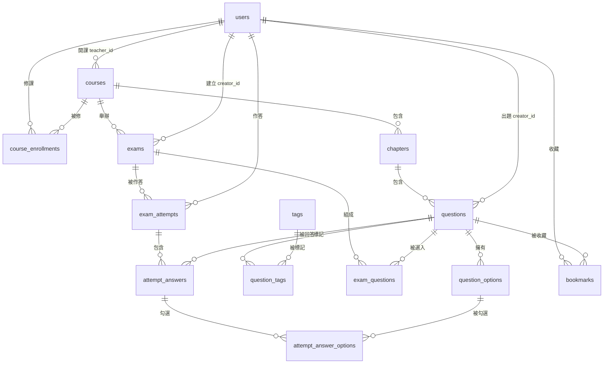

# 02 資料庫設計

MySQL 8.0.16+ 或 **XAMPP 內建的 MariaDB 10.4+**，資料庫名 `quiz_system`，儲存引擎 InnoDB，字元集 `utf8mb4`（排序 `utf8mb4_unicode_ci`）。完整建表語法在 [`database/schema.sql`](../database/schema.sql)，測試資料在 [`database/seed.sql`](../database/seed.sql)，匯入方式見 [`database/README.md`](../database/README.md)。本文件說明結構、關係與設計取捨。

## 1. 資料表總覽

### 1.1 十四張資料表

| # | 資料表 | 性質 | 說明 |
| --- | --- | --- | --- |
| 1 | `users` | 主檔 | 使用者，含角色 `student` / `teacher` / `admin` |
| 2 | `courses` | 主檔 | 課程，`teacher_id` 指向開課老師 |
| 3 | `course_enrollments` | 關聯（多對多） | 學生修課，複合主鍵 `(course_id, user_id)` |
| 4 | `chapters` | 主檔 | 課程章節 |
| 5 | `questions` | 主檔 | 題庫，含題型、難度、解析、軟刪除旗標 |
| 6 | `question_options` | 明細（主從） | 題目的選項與正確答案標記 |
| 7 | `tags` | 主檔 | 標籤，名稱唯一 |
| 8 | `question_tags` | 關聯（多對多） | 題目與標籤 |
| 9 | `exams` | 主檔／設定 | 考卷：限時、開放時段、及格分、次數上限、狀態 |
| 10 | `exam_questions` | 關聯（多對多，帶屬性） | 考卷包含哪些題目與配分、順序 |
| 11 | `exam_attempts` | 交易（單據） | 學生的一次作答 |
| 12 | `attempt_answers` | 交易明細 | 一次作答中每題的回答與得分 |
| 13 | `attempt_answer_options` | 交易明細（多對多） | 客觀題勾選了哪些選項 |
| 14 | `bookmarks` | 關聯（多對多，帶屬性） | 收藏題目與筆記 |

### 1.2 欄位重點

| 資料表 | 關鍵欄位 |
| --- | --- |
| `users` | `user_id` PK、`email` UNIQUE、`password_hash`、`role`、`is_active`、`must_change_password` |
| `courses` | `course_id` PK、`teacher_id` FK → users |
| `course_enrollments` | `(course_id, user_id)` PK、`enrolled_at` |
| `chapters` | `chapter_id` PK、`course_id` FK、`sort_order` |
| `questions` | `question_id` PK、`chapter_id` FK、`creator_id` FK、`type`、`difficulty`、`explanation`、`is_active` |
| `question_options` | `option_id` PK、`question_id` FK、`is_correct`、`sort_order` |
| `tags` | `tag_id` PK、`name` UNIQUE |
| `exams` | `exam_id` PK、`course_id` FK、`creator_id` FK、`duration_min`、`start_time`、`end_time`、`pass_score`、`max_attempts`、`status` |
| `exam_questions` | `(exam_id, question_id)` PK、`score`、`sort_order` |
| `exam_attempts` | `attempt_id` PK、`(exam_id, user_id, attempt_no)` UNIQUE、`started_at`、`submitted_at`、`total_score`、`status` |
| `attempt_answers` | `answer_id` PK、`(attempt_id, question_id)` UNIQUE、`answer_text`、`is_correct`、`score_awarded` |
| `attempt_answer_options` | `(answer_id, option_id)` PK |
| `bookmarks` | `(user_id, question_id)` PK、`note` |

### 1.3 共用慣例

- 主鍵使用 `INT UNSIGNED AUTO_INCREMENT`，命名為 `<表名單數>_id`；純關聯表使用複合主鍵。
- 列舉欄位使用 `ENUM`，新增值須經 schema 變更審查。
- 布林欄位使用 `TINYINT(1)`，`1` 為真。
- 所有時間欄位一律使用 `DATETIME`（`created_at` 預設 `CURRENT_TIMESTAMP`），不用 `TIMESTAMP`，避免 MariaDB 舊版對第一個 TIMESTAMP 欄位自動加上 `ON UPDATE` 的行為，也沒有 2038 年問題。
- **時區**：PDO 連線後執行 `SET time_zone = '+08:00'`，PHP 設定 `Asia/Taipei`；API 輸出 ISO 8601（含 `+08:00`）。
- 所有表使用 InnoDB，否則外鍵與 transaction 無效。
- 密碼只存 `password_hash()` 的結果，`VARCHAR(255)`。

## 2. 資料表關係

### 2.1 ER 圖



### 2.2 關係說明

| 關係 | 型態 | 實作 |
| --- | --- | --- |
| 老師 — 課程 | 1 : N | `courses.teacher_id` |
| 學生 — 課程 | N : M | `course_enrollments` |
| 課程 — 章節 — 題目 — 選項 | 1 : N 逐層 | 各表的外鍵 |
| 題目 — 標籤 | N : M | `question_tags` |
| 考卷 — 題目 | N : M，帶配分與順序 | `exam_questions` |
| 考卷 — 作答 | 1 : N | `exam_attempts.exam_id` |
| 學生 — 作答 | 1 : N | `exam_attempts.user_id` |
| 作答 — 作答明細 | 1 : N | `attempt_answers.attempt_id` |
| 作答明細 — 勾選選項 | N : M | `attempt_answer_options` |
| 學生 — 收藏題目 | N : M，帶筆記 | `bookmarks` |

### 2.3 外鍵刪除策略

| 外鍵 | `ON DELETE` | 理由 |
| --- | --- | --- |
| `course_enrollments` → `courses` / `users` | CASCADE | 修課紀錄隨課程或使用者消失 |
| `chapters` → `courses` | CASCADE | 課程刪除時連帶章節（API 已限制只能刪空課程） |
| `courses.teacher_id` → `users` | RESTRICT | 有開課的老師不可被刪除 |
| `questions` → `chapters` / `users` | RESTRICT | 有題目的章節不可刪；出題者不可刪 |
| `question_options` → `questions` | CASCADE | 選項隨題目；題目實際上不會被硬刪 |
| `question_tags` → `questions` / `tags` | CASCADE | 刪標籤只解除關聯 |
| `exams` → `courses` / `users` | RESTRICT | 有考卷的課程不可刪 |
| `exam_questions` → `exams` | CASCADE | 考卷刪除時連帶題目清單（僅草稿可刪） |
| `exam_questions` → `questions` | RESTRICT | 被考卷使用的題目不可硬刪 |
| `exam_attempts` → `exams` / `users` | RESTRICT | **作答紀錄是歷史，不可因刪考卷或使用者而消失** |
| `attempt_answers` → `exam_attempts` | CASCADE | 明細隨單據 |
| `attempt_answers` → `questions` | RESTRICT | 有作答的題目不可硬刪 |
| `attempt_answer_options` → `attempt_answers` | CASCADE | 隨明細 |
| `attempt_answer_options` → `question_options` | RESTRICT | **有人勾選過的選項不可被刪除或重建**，自然擋下「改寫已被作答題目的選項」 |
| `bookmarks` → `users` / `questions` | CASCADE | 收藏是個人輔助資料 |

## 3. 補充

### 3.1 約束（CHECK 與唯一鍵）

`CHECK` 在 MySQL 8.0.16+ 與 MariaDB 10.2.1+ 才會實際執行（舊版 MySQL 5.7 會**默默忽略**）。以下約束都已寫在 `schema.sql` 的 `CREATE TABLE` 內，這裡列出以便對照：

```sql
-- users：另有 is_active TINYINT(1) NOT NULL DEFAULT 1（停用帳號，不實體刪除）
--        與 must_change_password TINYINT(1) NOT NULL DEFAULT 0（1 = 登入後必須先改密碼，F-22）

-- questions
ALTER TABLE questions
  ADD CONSTRAINT chk_question_difficulty CHECK (difficulty BETWEEN 1 AND 3);

-- exams
ALTER TABLE exams
  ADD CONSTRAINT chk_exam_duration  CHECK (duration_min > 0),
  ADD CONSTRAINT chk_exam_attempts  CHECK (max_attempts >= 1),
  ADD CONSTRAINT chk_exam_pass      CHECK (pass_score >= 0),
  ADD CONSTRAINT chk_exam_window    CHECK (end_time IS NULL OR start_time IS NULL OR end_time > start_time);

-- exam_questions
ALTER TABLE exam_questions
  ADD CONSTRAINT chk_eq_score CHECK (score > 0);

-- exam_attempts / attempt_answers
ALTER TABLE exam_attempts
  ADD CONSTRAINT chk_attempt_no CHECK (attempt_no >= 1);
ALTER TABLE attempt_answers
  ADD CONSTRAINT chk_answer_score CHECK (score_awarded >= 0);
```

| 唯一鍵 | 用途 |
| --- | --- |
| `users.email` | 登入帳號不重複 |
| `tags.name` | 標籤不重複 |
| `exam_attempts (exam_id, user_id, attempt_no)` | 保證序號不重複，並在併發下作為最後防線 |
| `attempt_answers (attempt_id, question_id)` | 一次作答中每題只有一筆，支援 `INSERT ... ON DUPLICATE KEY UPDATE` 暫存 |

> `users.is_active`（使用者有歷史外鍵不能硬刪，只能停用）、`users.must_change_password`（F-22）與上述 CHECK 約束，是相較於最初草案**新增**的。已匯入舊版 `schema.sql` 的資料庫，可執行 [`database/migrations/001_add_must_change_password.sql`](../database/migrations/001_add_must_change_password.sql)，或直接重新匯入 `schema.sql` + `seed.sql`。

### 3.2 索引

主鍵、唯一鍵與外鍵欄位 MySQL 會自動建立索引。額外建議：

| 索引 | 對應查詢 |
| --- | --- |
| `questions (chapter_id, is_active, difficulty)` | 題庫列表篩選、隨機抽題 |
| `chapters (course_id, sort_order)` | 章節依序列出 |
| `exams (course_id, status)` | 各課程已發佈考卷 |
| `exam_attempts (user_id, exam_id)` | 學生的作答紀錄、次數檢查 |
| `exam_attempts (status, started_at)` | 逾時作答掃描（F-18） |
| `attempt_answers (question_id)` | 各題答對率統計 |
| `question_options (question_id, sort_order)` | 依序取出選項 |

### 3.3 設計理由

1. **選項表共用於三種客觀題**：是非題固定兩個選項（對 / 錯）、單選恰一個 `is_correct = 1`、多選可有多個，簡答題沒有選項。不需要為題型各開一張表。
2. **多選作答必須獨立成 `attempt_answer_options`**：若把勾選的 `option_id` 存成逗號字串會違反第一正規形，也無法 JOIN 批改。
3. **配分放在 `exam_questions`，不放在 `questions`**：同一題在不同考卷可有不同分數。
4. **作答開始時預先建立每題的 `attempt_answers`**：未作答的題目也有一列，批改與統計都不會漏算；暫存改用 `UPDATE` / upsert。
5. **`is_correct` 允許 NULL**：`NULL` = 尚未批改（簡答題待評分）；`0` = 答錯；`1` = 答對。
6. **`score_awarded` 是計算結果的快照**：保留得分，之後即使題目配分被調整（草稿階段）也不影響已交卷的紀錄；已發佈考卷的配分本來就鎖定。
7. **`exam_attempts.total_score` 為冗餘欄位**：由 `attempt_answers.score_awarded` 加總而來，換取列表查詢不必每次聚合；任何改分操作必須同一 transaction 內重算。
8. **軟刪除題目**：`questions.is_active` 控制能否被新考卷挑選，不影響既有考卷與歷史作答。
9. **「是否通過」不存欄位**：以 `total_score >= exams.pass_score` 計算，避免與及格分數不同步。

### 3.4 Transaction 與併發

預設隔離層 `REPEATABLE READ`（InnoDB 預設）。下列流程必須包在單一 transaction，鎖定規則詳見 [04 §14](04-behavior.md#14-併發與一致性)：

| 流程 | 寫入的資料表 |
| --- | --- |
| 新增／修改題目 | `questions`、`question_options`、`tags`、`question_tags` |
| 整份取代考卷題目 | `exam_questions` |
| 開始作答 | `exam_attempts`、`attempt_answers` |
| 交卷批改 | `attempt_answers`、`exam_attempts` |
| 人工評分 | `attempt_answers`、`exam_attempts` |
| 匯入題目 | 同「新增題目」，整批單一 transaction |

應用層依 MySQL 錯誤碼轉成 domain 錯誤，不比對錯誤文字（對應見 [05 §7](05-architecture.md#7-錯誤處理)）。

### 3.5 常用查詢範例

**各題答對率**（老師找出難題或有誤的題目）

```sql
SELECT q.question_id, q.content,
       COUNT(*)                          AS answered,
       SUM(aa.is_correct = 1)            AS correct,
       ROUND(100 * AVG(aa.is_correct = 1), 1) AS correct_rate
FROM attempt_answers aa
JOIN exam_attempts ea ON ea.attempt_id = aa.attempt_id AND ea.status = 'graded'
JOIN questions q      ON q.question_id = aa.question_id
WHERE ea.exam_id = ?
GROUP BY q.question_id, q.content
ORDER BY correct_rate ASC;
```

**章節弱點**（學生個人，班級版把條件改成課程並移除 `user_id`）

```sql
SELECT c.chapter_id, c.name,
       COUNT(*)                AS total,
       SUM(aa.is_correct = 1)  AS correct,
       ROUND(100 * AVG(aa.is_correct = 1), 1) AS correct_rate
FROM attempt_answers aa
JOIN exam_attempts ea ON ea.attempt_id = aa.attempt_id AND ea.status = 'graded'
JOIN questions q      ON q.question_id = aa.question_id
JOIN chapters c       ON c.chapter_id  = q.chapter_id
WHERE ea.user_id = ? AND c.course_id = ?
GROUP BY c.chapter_id, c.name
ORDER BY correct_rate ASC;
```

**錯題本**（只納入已可檢視解析的考卷，規則見 [04 §11](04-behavior.md#11-成績與解析可見性)）

```sql
SELECT q.question_id, q.content,
       COUNT(*)            AS wrong_times,
       MAX(ea.submitted_at) AS last_wrong_at
FROM attempt_answers aa
JOIN exam_attempts ea ON ea.attempt_id = aa.attempt_id
JOIN exams e          ON e.exam_id = ea.exam_id
JOIN questions q      ON q.question_id = aa.question_id
WHERE ea.user_id = ?
  AND ea.status IN ('submitted', 'graded')
  AND aa.is_correct = 0
  AND (e.status = 'closed' OR e.end_time < NOW())
GROUP BY q.question_id, q.content
ORDER BY last_wrong_at DESC;
```

**考卷分數分佈 / 及格率**

```sql
SELECT COUNT(*)                             AS attempts,
       ROUND(AVG(ea.total_score), 2)        AS avg_score,
       MAX(ea.total_score)                  AS max_score,
       MIN(ea.total_score)                  AS min_score,
       ROUND(100 * AVG(ea.total_score >= e.pass_score), 1) AS pass_rate
FROM exam_attempts ea
JOIN exams e ON e.exam_id = ea.exam_id
WHERE ea.exam_id = ? AND ea.status = 'graded';
```

### 3.6 測試資料（seed）

主檔類（課程、考卷）數量較少，明細與交易類資料表都在 10 筆以上，足夠展示 JOIN 與統計。實際規模：

| 資料 | 數量 |
| --- | --- |
| 使用者 | 24 位：1 位管理員、3 位老師、20 位學生 |
| 課程 / 章節 | 4 門課、14 個章節 |
| 修課 | 43 筆 |
| 題目 / 選項 | 40 題（單選、多選、是非、簡答都有，難度 1 / 2 / 3）、120 個選項 |
| 標籤 | 12 個，題目與標籤 53 筆關聯 |
| 考卷 | 6 份：草稿 1、已發佈 3（含一份尚未開放）、已關閉 2；共 49 筆題目配置 |
| 作答 | 39 次：作答中 2、已交卷待評分 6、已批改 31；共 310 筆作答明細、318 筆勾選選項 |
| 收藏 | 16 筆 |

所有測試帳號密碼皆為 `Test1234!`（雜湊為 bcrypt `$2y$`，可直接被 PHP 的 `password_verify()` 驗證）。其中 `s020@example.edu.tw`（user_id 24）被標記為「須先改密碼」，用來測試 F-22 流程。測試帳號與各情境的位置見 [`database/README.md`](../database/README.md)。作答中（`in_progress`）的兩筆以 `NOW()` 起算，匯入後約 30 分鐘內可測試續答。

### 3.7 擴充預留

| 擴充 | 做法 |
| --- | --- |
| 答案揭露時機可設定 | `exams` 新增 `show_answers ENUM('after_submit','after_close') DEFAULT 'after_close'`（P2） |
| 多老師授課 | 新增 `course_teachers (course_id, user_id)`，取代 `courses.teacher_id` |
| 公告 | 新增 `announcements` |
| 題目錯誤回報 | 新增 `question_reports` |
| 登入紀錄 | 新增 `login_logs` |
| 簡答題評語 | `attempt_answers` 新增 `grader_comment TEXT` |
| 忘記密碼（Email 重設連結） | 新增 `password_resets (token_hash, user_id, expires_at, used_at)`；需要寄信 |
| 重設密碼後立即踢出既有登入 | `users` 新增 `password_changed_at DATETIME`，登入時記錄於 session，不一致就視為失效 |

### 3.8 XAMPP（MariaDB）與 MySQL 8 的相容性

XAMPP 內建的「MySQL」其實是 **MariaDB**（XAMPP 8.x 多為 10.4）。本專案的 SQL 同時以 MariaDB 10.11 實測過，並刻意避開兩者不同的語法：

| 項目 | MySQL 8.0 | MariaDB 10.4（XAMPP） | 本專案的做法 |
| --- | --- | --- | --- |
| `CHECK` 約束 | 8.0.16+ 生效 | 10.2.1+ 生效 | 直接使用；違反時錯誤碼分別為 `3819` / `4025` |
| 共享鎖 | `FOR SHARE` | 不支援，要用 `LOCK IN SHARE MODE` | 一律寫 `LOCK IN SHARE MODE`（兩邊都支援） |
| `SKIP LOCKED` | 8.0.1+ | 10.6+ | **不使用**，逾時處理改成「先挑候選、逐筆鎖定並重新檢查」 |
| `FOR UPDATE OF 表名` | 8.0.1+ | 不支援 | 不使用 |
| 預設排序規則 | `utf8mb4_0900_ai_ci` | `utf8mb4_general_ci` | 明確指定 `utf8mb4_unicode_ci` |
| `TIMESTAMP` 預設行為 | 不自動 `ON UPDATE` | 10.9 以前第一個 TIMESTAMP 欄位會自動加 | 時間欄位全用 `DATETIME` |
| `ORDER BY RAND()`、`DECIMAL`、`ENUM`、`ON DUPLICATE KEY UPDATE` | 支援 | 支援 | 直接使用 |

若之後要部署到 MySQL 8 或 Docker 的 `mysql:8.0` 映像檔，不需要改任何 SQL。

