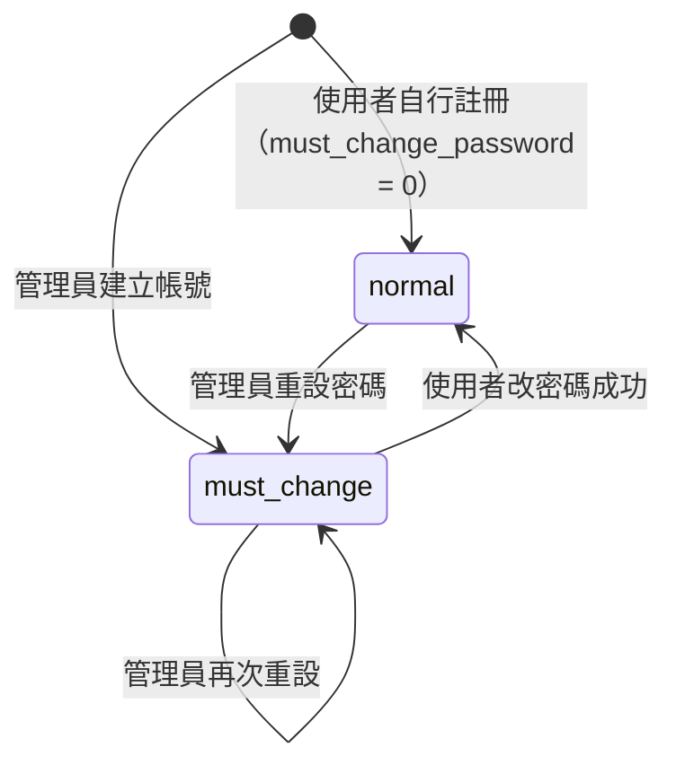
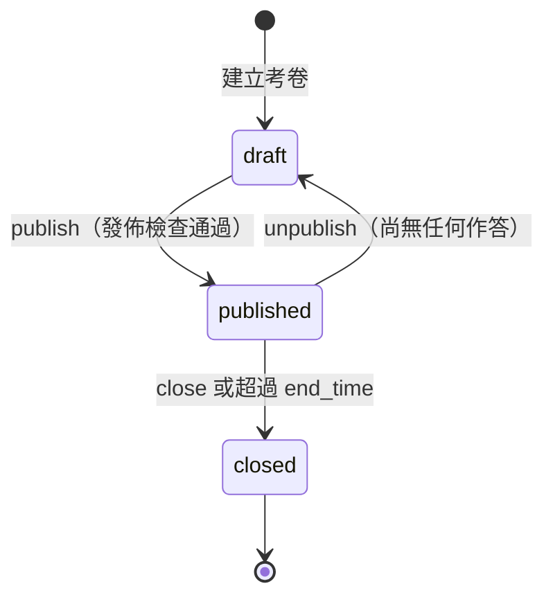
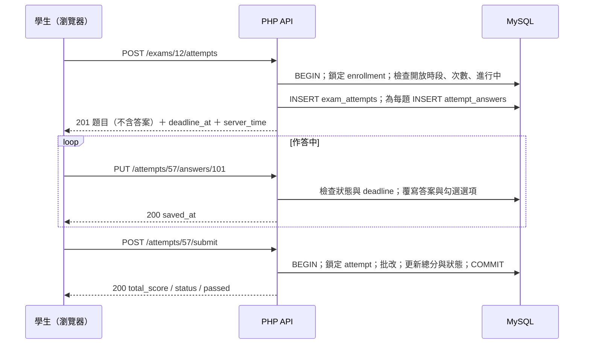
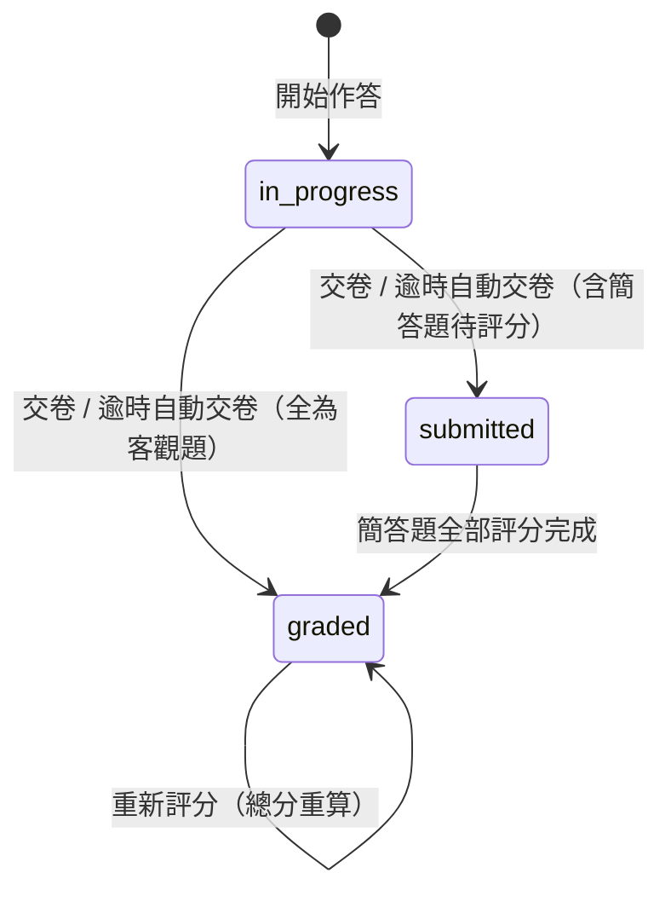

# 04 行為邏輯

本文件描述系統「怎麼運作」：流程、狀態機、權限與業務規則。資料結構見 [02](02-database.md)，端點見 [03](03-api.md)。

## 1. 通用規則

| 編號 | 規則 |
| --- | --- |
| BR-01 | 所有時間判斷以**伺服器時間**為準（`Asia/Taipei`），不採信前端傳入的時間。 |
| BR-02 | 所有 ID 取自路徑或 body，伺服器一律重新驗證其存在與歸屬，不信任前端傳來的 `user_id`、`teacher_id`、`score`、`status`。 |
| BR-03 | 「目前使用者」只來自 session，不來自 request。 |
| BR-04 | 對無權限查看的資源回 `404`，避免洩漏資源存在。 |
| BR-05 | 學生端任何 response 在作答期間不得包含 `is_correct`、`explanation`。 |
| BR-06 | 跨資料表的寫入一律在單一 transaction 內完成，失敗全部回滾。 |
| BR-07 | 已有作答的資料（題目內容、選項、配分）不可被改寫；歷史紀錄不刪除。 |
| BR-08 | 所有 SQL 使用 Prepared Statement，參數綁定。 |

## 2. 角色與權限矩陣

`✓` 允許、`✗` 禁止、`○` 僅限**自己開設課程**下的資源。判定「自己的課程」的方式：沿資源往上追到 `courses.teacher_id = 目前使用者`。

| 操作 | 學生 S | 老師 T | 管理員 A |
| --- | --- | --- | --- |
| 註冊 / 登入 / 登出 / 改個人資料與密碼 | ✓ | ✓ | ✓ |
| 瀏覽課程列表 | ✓ | ✓ | ✓ |
| 開課 | ✗ | ✓ | ✓ |
| 修改／刪除課程 | ✗ | ○ | ✓ |
| 加入／退選課程 | ✓ | ✗ | ✗ |
| 查看修課名單、移除學生 | ✗ | ○ | ✓ |
| 管理章節 | ✗ | ○ | ✓ |
| 管理題目（新增、修改、停用、匯入） | ✗ | ○ | ✓ |
| 管理標籤 | ✗ | ✓ | ✓（含刪除） |
| 建立／編輯／刪除考卷、組卷 | ✗ | ○ | ✓ |
| 發佈／撤回／關閉考卷 | ✗ | ○ | ✓ |
| 參加測驗（開始、作答、交卷） | ✓（需已修課） | ✗ | ✗ |
| 查看自己的作答與成績 | ✓ | — | — |
| 查看全班作答與成績 | ✗ | ○ | ✓ |
| 簡答題人工評分 | ✗ | ○ | ✓ |
| 統計報表 | 僅個人 | ○ | ✓ |
| 收藏題目／錯題本 | ✓ | ✗ | ✗ |
| 使用者管理 | ✗ | ✗ | ✓ |
| 重設他人密碼（F-22） | ✗ | ✗ | ✓ |

**檢查順序**（每個受保護端點）：已登入 → 帳號啟用 → 是否須先改密碼（旗標為 1 時只放行 `GET /me`、`PUT /me/password`、`POST /auth/logout`）→ CSRF（寫入請求）→ 角色 → 擁有權／修課關係 → 資源狀態。

**403 與 404 的選擇**

| 資源 | 沒有權限時 | 理由 |
| --- | --- | --- |
| 課程本身、章節 | `403 FORBIDDEN` | 大家都看得到，不需要隱藏它存在 |
| 修課名單、題庫、題目 | `404 NOT_FOUND` | 不公開，回 404 就不會洩漏「這個 ID 存在」 |
| 題庫列表 | 只回自己的；別人的課程回空清單 | 同上 |

## 3. 帳號與登入流程

### 3.1 註冊（學生）

1. 驗證 `username`、`email`、`password`（長度 ≥ 8）。
2. email 轉小寫後檢查唯一；`INSERT` 時以唯一鍵為最後防線，捕捉重複鍵錯誤回 `EMAIL_TAKEN`。
3. `role` 固定為 `student`；密碼以 `password_hash()` 儲存。
4. 註冊成功後導向登入，不自動登入。

### 3.2 登入

1. 以 email 查使用者；不存在也要執行一次假的 `password_verify()`，降低以回應時間判斷帳號是否存在的風險。
2. 密碼錯誤或帳號不存在 → `INVALID_CREDENTIALS`；`is_active = 0` → `ACCOUNT_DISABLED`。
3. 成功：`session_regenerate_id(true)`，寫入 `user_id`、`role`，產生 `csrf_token` 存入 session。
4. 回應帶 `must_change_password`（來自 `users.must_change_password`），前端據此導向改密碼頁面。
5. 若 `password_needs_rehash()` 為真，順便更新雜湊。

### 3.3 登出

銷毀 session 並清除 Cookie。

### 3.4 修改密碼

`PUT /me/password`

1. 驗證輸入：`new_password` 長度 ≥ 8，且**不得與 `old_password` 相同**，否則 `VALIDATION_FAILED`。
2. 以 `password_verify()` 檢查舊密碼，不符 → `WRONG_PASSWORD`。對「須先改密碼」的帳號，舊密碼就是管理員給的臨時密碼。
3. 更新：`UPDATE users SET password_hash = ?, must_change_password = 0 WHERE user_id = ?`（目前使用者取自 session）。
4. `session_regenerate_id(true)`，回傳 `{ must_change_password: false }`。

連續輸入錯誤舊密碼的次數限制屬 P2（與登入防爆破一併處理）。

### 3.5 管理員重設密碼

`POST /admin/users/{user_id}/reset-password`

```
驗證：目前使用者為 admin（Role middleware）
→ 目標使用者存在                                         → NOT_FOUND
→ 目標 ≠ 目前使用者                                      → CANNOT_MODIFY_SELF
→ 產生臨時密碼：12 碼，字元集排除 0 O 1 l I 等易混淆字元，
   每個字元用 random_int() 抽取；至少含大寫、小寫與數字各一（不符就重抽）
→ UPDATE users SET password_hash = <password_hash(臨時密碼)>, must_change_password = 1
   WHERE user_id = ?
→ 回傳 temp_password（僅此一次）
```

- 臨時密碼**不存明文、不寫入 log、不放進 URL**；回應標頭加 `Cache-Control: no-store`。
- 單一 `UPDATE` 即可，不需額外 transaction。兩位管理員同時重設同一人時，後者覆蓋前者（前一組臨時密碼失效），可接受。
- 目標已停用（`is_active = 0`）仍可重設，但在重新啟用前依然無法登入。
- **限制**：目標既有的 session 不會被立即登出，最長在 `SESSION_LIFETIME`（預設 2 小時）閒置後失效；要立即失效需 `password_changed_at`（P2，見 [02 §3.7](02-database.md#37-擴充預留)）。
- 如何把臨時密碼交給使用者（當面、私訊）不在系統範圍內。

### 3.6 須先改密碼的狀態



`must_change` 狀態下，只放行下列端點，其餘一律回 `403 PASSWORD_CHANGE_REQUIRED`：

| 端點 | 用途 |
| --- | --- |
| `GET /me` | 讓前端知道目前狀態 |
| `PUT /me/password` | 改密碼（唯一能解除此狀態的方式） |
| `POST /auth/logout` | 允許登出 |
| `GET /health` | 健康檢查（不需登入） |

實作上是 Auth 之後的一個 Middleware（`MustChangePassword`），檢查 session 載入的使用者旗標。管理員建立帳號（F-17）時同樣設為 `must_change`，使用者首次登入必須改掉初始密碼。

## 4. 題目規則與出題流程

### 4.1 題型規則

| 題型 | 選項數 | 正確答案數 | 其他 |
| --- | --- | --- | --- |
| `single` 單選 | 2 ~ 6 | 恰 1 | |
| `multiple` 多選 | 3 ~ 8 | ≥ 1（建議 ≥ 2） | 全對才給分 |
| `truefalse` 是非 | 恰 2（對 / 錯） | 恰 1 | 選項文字固定為「對」「錯」 |
| `short` 簡答 | 0（不得有選項） | — | 由老師人工評分 |

違反 → `INVALID_QUESTION_SHAPE`。

### 4.2 新增題目流程

```
驗證請求與題型規則
→ 檢查章節屬於目前老師的課程（管理員除外）
→ BEGIN
   → INSERT questions
   → INSERT question_options（逐筆，含 sort_order）
   → 標籤：以名稱正規化（trim、不分大小寫）後
       INSERT ... ON DUPLICATE KEY UPDATE 取得 tag_id
   → INSERT question_tags
→ COMMIT
```

任一步驟失敗整筆回滾，不留下沒有選項的題目。

### 4.3 修改題目

「**已被使用**」的定義：該題出現在 `published` 或 `closed` 考卷的 `exam_questions`，或存在於任一 `attempt_answers`。

| 欄位 | 未被使用 | 已被使用 |
| --- | --- | --- |
| 題型、題幹、選項（內容與正確答案） | 可改 | **禁止**，回 `QUESTION_IN_USE` |
| 解析、難度、標籤、章節 | 可改 | 可改 |
| `is_active` | 可改 | 可改 |

`PUT /questions/{id}`（整題取代）的實作：未被使用 → 刪除舊選項再重建；已被使用 → 比對題型、題幹、選項，只要有差異就拒絕。資料庫的 `attempt_answer_options → question_options` 為 RESTRICT，是這條規則的最後防線。

`PUT` 另外有一條規則：題目**不能搬到別門課程**的章節（它可能已經在原課程的考卷裡），換章節只限同一門課程內。

### 4.4 停用題目

`DELETE /questions/{id}` 即 `is_active = 0`。停用後：不能被新的草稿考卷挑選、不會被隨機抽題抽到；已在考卷中的不受影響；歷史作答與統計照常。

## 5. 組卷與發佈流程

### 5.1 手動組卷

```
BEGIN
→ SELECT exams WHERE exam_id = ? FOR UPDATE
→ 確認 status = 'draft'，否則 EXAM_NOT_EDITABLE
→ 驗證所有 question_id：屬於本考卷所在課程、is_active = 1
→ DELETE FROM exam_questions WHERE exam_id = ?
→ INSERT 新清單（score、sort_order）
COMMIT
```

整份取代，避免逐題增刪造成的中間狀態與順序錯亂。

### 5.2 隨機抽題

1. 候選集合：`is_active = 1`、章節在指定範圍（不給＝整門課）、（若有）帶有**任何一個**指定標籤、**不在本考卷中**。
2. 依 `by_difficulty`（各難度題數）對每個難度分別抽取；若改給 `count`，則不分難度、一次抽出總題數（兩者必須擇一）：

   ```sql
   SELECT question_id FROM questions
   WHERE chapter_id IN (...) AND is_active = 1 AND difficulty = ? AND question_id NOT IN (...)
   ORDER BY RAND() LIMIT ?;
   ```

   整個流程在 transaction 內、並先鎖住考卷那一列（`SELECT ... FOR UPDATE`），所以兩個人同時抽題會一個接一個執行。

3. 任一難度可用題數不足 → 不寫入任何東西，回 `INSUFFICIENT_QUESTIONS` 並列出缺口。
4. 通過後，以 `score_each`（預設 1）加入 `exam_questions`，`sort_order` 接在現有題目之後；回應是**新加入的題目**，`meta` 帶新增數、總題數與總分。
5. 一份考卷最多 200 題。

`ORDER BY RAND()` 在題庫數千題以內效能足夠；超過時改為「先取符合條件的 ID，在 PHP 端洗牌取樣」。

### 5.3 發佈檢查

發佈前一併驗證，**全部通過才改狀態**，未通過時 `details` 列出**所有**失敗規則（沒有題目時只回報 `no_questions`，因為總分相關的檢查沒有意義）：

發佈、撤回、關閉都在 transaction 內先鎖住考卷，再重新讀取狀態，所以兩個人同時操作時只有一個成功。

| 規則 | 條件 |
| --- | --- |
| `no_questions` | 至少 1 題 |
| `question_inactive` | 所有題目 `is_active = 1` |
| `question_shape_invalid` | 每題符合 §4.1 題型規則（直接檢查資料庫中的選項，不信任當初新增時的驗證），`details` 附上原因 |
| `total_score_zero` | 總分 > 0 |
| `pass_score_exceeds_total` | `pass_score ≤ 總分` |
| `invalid_window` | 同時設定時 `start_time < end_time` |
| `end_in_past` | `end_time` 若有設定，必須晚於現在 |
| `duration_invalid` | `duration_min > 0` |

## 6. 考卷狀態機



| 目前狀態 | 動作 | 條件 | 結果 |
| --- | --- | --- | --- |
| `draft` | publish | 通過 §5.3 | `published` |
| `draft` | 刪除 | 無 | 實體刪除（`exam_questions` 連動） |
| `published` | unpublish | `exam_attempts` 無任何紀錄 | `draft`；否則 `HAS_ATTEMPTS` |
| `published` | close | 無 | `closed`，進行中的作答仍可在各自 deadline 前完成 |
| `published` | 超過 `end_time` | 自動 | 視為已結束（見下） |
| `closed` | 任何轉換 | — | `EXAM_INVALID_STATE`（重新開放列為 P2） |

**有效狀態（effective status）**：`status = 'published'` 但 `now > end_time` 時，系統**在讀取時**視為已結束，不需排程去改資料。凡是需要判斷「是否可作答」「是否可看解析」的地方都使用同一個函式 `Exam::isOpen()` / `Exam::isEnded()`。

**各狀態下可修改的欄位**

| 狀態 | 可修改 |
| --- | --- |
| `draft` | 全部設定、題目與配分 |
| `published` | `title`；`end_time` 只能**延長**（新的結束時間必須晚於現在與原本的結束時間），或設為 `null` 移除結束時間；原本沒有結束時間的考卷不能再設定一個（等於縮短）。其餘鎖定，回 `EXAM_NOT_EDITABLE` 並列出被鎖定的欄位 |
| `closed` | 僅 `title` |

**刪除**：只有 `draft` 可以刪除（否則 `EXAM_NOT_EDITABLE`）；草稿卻有作答紀錄（異常資料）回 `HAS_ATTEMPTS`。

**學生看到什麼**：草稿對學生「不存在」（404）；已發佈／已關閉的考卷，沒修課的學生回 `403 NOT_ENROLLED`；修課的學生只拿到設定與 `my_attempts`（`used`、`best_score`、`in_progress_attempt_id`、`can_start`），**永遠沒有題目內容**。`can_start` ⇔ 開放中 且 `used < max_attempts` 且沒有進行中的作答。

**開放時段判定**：可開始作答 ⇔ `status = 'published'` 且（`start_time` 為空或 ≤ now）且（`end_time` 為空或 > now）。

## 7. 作答流程

### 7.1 時序



### 7.2 開始作答

```
BEGIN
→ 驗證：學生已修該課程（course_enrollments）               → NOT_ENROLLED
→ SELECT course_enrollments WHERE (course_id, user_id) FOR UPDATE   ← 每位學生的互斥鎖
→ SELECT exams ... LOCK IN SHARE MODE；確認在開放時段         → EXAM_NOT_OPEN
→ 若已有 status = 'in_progress' 的作答                      → ATTEMPT_IN_PROGRESS（回傳該 attempt_id）
→ n = COUNT(exam_attempts WHERE exam_id, user_id)
→ 若 n ≥ max_attempts                                      → ATTEMPT_LIMIT_REACHED
→ INSERT exam_attempts (attempt_no = n + 1, started_at = NOW(), status = 'in_progress')
→ INSERT attempt_answers 每題一列（answer_text NULL、is_correct NULL、score_awarded 0）
COMMIT
```

- **次數判斷計入所有狀態**，包含作答中，避免以「開了不交」規避。
- 鎖定 `course_enrollments` 這一列當作「每位學生一把鎖」，兩個分頁同時按開始時第二個請求會等待，等到時就會看到已有進行中的作答。`(exam_id, user_id, attempt_no)` 唯一鍵是最後防線。

### 7.3 截止時間

```
deadline_at = min( started_at + duration_min 分鐘,  exams.end_time（若有） )
```

- 在伺服器計算並回傳；前端用 `deadline_at - server_time` 倒數。
- 暫存與交卷皆以 `NOW()` 對照 `deadline_at` 判斷。容許 **5 秒**寬限（`ATTEMPT_GRACE_SECONDS`）涵蓋網路延遲。

### 7.4 暫存答案

```
BEGIN
→ SELECT exam_attempts WHERE attempt_id = ? AND user_id = 目前使用者 FOR UPDATE
→ status ≠ 'in_progress'                      → ATTEMPT_NOT_EDITABLE
→ NOW() > deadline_at + 寬限                   → ATTEMPT_EXPIRED
→ 該 question_id 必須屬於本次作答（attempt_answers 已有該列）→ 否則 NOT_FOUND
→ 依題型驗證：
    single / truefalse：option_ids 至多 1 個
    multiple：option_ids 任意數量，不得重複
    short：answer_text 長度 ≤ 5000
    每個 option_id 必須屬於該題                  → INVALID_OPTION
→ DELETE attempt_answer_options WHERE answer_id = ?
→ INSERT 新勾選；UPDATE attempt_answers.answer_text（簡答題）
COMMIT
```

### 7.5 交卷

```
BEGIN
→ SELECT exam_attempts ... FOR UPDATE
→ status ≠ 'in_progress'：直接回傳現有結果（冪等，不報錯）
→ 若 NOW() ≤ deadline_at + 寬限 且 body 含 answers：先套用最後的答案
   若已逾時：忽略 body，只採計已暫存的答案，late = true
→ 批改（§9）
→ UPDATE exam_attempts：submitted_at = NOW()、total_score、status
COMMIT
```

### 7.6 續答

`GET /attempts/{id}`：僅當 `status = 'in_progress'` 時回傳題目與已暫存答案（不含正確答案）；已交卷的作答改用 `/result`。頁面重新整理後以此恢復作答。

**實作補充（M4）**：開始作答時先鎖該學生的修課紀錄那一列，再對考卷取 `LOCK IN SHARE MODE`，所以「同時開始」與「老師撤回」不會出現重複作答或撤回後仍有作答。暫存與交卷都先 `SELECT ... FOR UPDATE` 鎖住作答單，鎖到之後再確認狀態（已用多 worker 伺服器同時送出請求測過）。

## 8. 作答狀態機



| 轉換 | 觸發 | 條件 |
| --- | --- | --- |
| `in_progress → submitted` | 交卷、逾時處理 | 考卷含簡答題且尚有 `is_correct IS NULL` 的簡答 |
| `in_progress → graded` | 交卷、逾時處理 | 沒有待評分的簡答題 |
| `submitted → graded` | 人工評分 | 最後一題簡答題給分後，待評分數為 0 |
| `graded → graded` | 人工重新評分 | 重算 `total_score` |

`submitted` 與 `graded` 都不可再修改答案。

## 9. 自動批改與計分

### 9.1 規則

| 題型 | 判定 | 得分 |
| --- | --- | --- |
| `single`、`truefalse` | 勾選的選項 = 唯一正確選項 | 答對得配分，否則 0 |
| `multiple` | 勾選集合 **完全等於** 正確選項集合 | 全對得配分，否則 0（部分給分列為擴充） |
| `short` | 不自動批改 | `is_correct = NULL`、`score_awarded = 0`，等待人工評分 |
| 未作答（沒有勾選） | 視為答錯 | 0 |

### 9.2 批改 SQL

交卷時在 transaction 內執行兩個 `UPDATE`。MySQL 多表 `UPDATE` 不保證 `SET` 的賦值順序，所以**分成兩步**，不要在同一個 `UPDATE` 內用剛算出的 `is_correct`。

步驟一：判定對錯

```sql
UPDATE attempt_answers aa
JOIN questions q ON q.question_id = aa.question_id AND q.type <> 'short'
SET aa.is_correct = (
      -- 至少勾選了一個
      EXISTS (SELECT 1 FROM attempt_answer_options x WHERE x.answer_id = aa.answer_id)
      -- 且沒有「勾了但不是正確」的選項
  AND NOT EXISTS (SELECT 1 FROM attempt_answer_options x
                  JOIN question_options o ON o.option_id = x.option_id
                  WHERE x.answer_id = aa.answer_id AND o.is_correct = 0)
      -- 且沒有「是正確但沒勾」的選項
  AND NOT EXISTS (SELECT 1 FROM question_options o
                  WHERE o.question_id = aa.question_id AND o.is_correct = 1
                    AND NOT EXISTS (SELECT 1 FROM attempt_answer_options x
                                    WHERE x.answer_id = aa.answer_id AND x.option_id = o.option_id))
)
WHERE aa.attempt_id = ?;
```

步驟二：給分

```sql
UPDATE attempt_answers aa
JOIN exam_attempts ea ON ea.attempt_id = aa.attempt_id
JOIN exam_questions eq ON eq.exam_id = ea.exam_id AND eq.question_id = aa.question_id
JOIN questions q ON q.question_id = aa.question_id AND q.type <> 'short'
SET aa.score_awarded = IF(aa.is_correct = 1, eq.score, 0)
WHERE aa.attempt_id = ?;
```

步驟三：總分與狀態

```sql
UPDATE exam_attempts ea
SET ea.total_score = (SELECT COALESCE(SUM(score_awarded), 0)
                      FROM attempt_answers WHERE attempt_id = ea.attempt_id),
    ea.submitted_at = NOW(),
    ea.status = IF(EXISTS (SELECT 1 FROM attempt_answers aa
                           JOIN questions q ON q.question_id = aa.question_id
                           WHERE aa.attempt_id = ea.attempt_id
                             AND q.type = 'short' AND aa.is_correct IS NULL),
                   'submitted', 'graded')
WHERE ea.attempt_id = ?;
```

### 9.3 通過判定與成績採計

- `passed = total_score >= exams.pass_score`，查詢時計算，不存欄位。
- `pass_score` 與配分使用相同單位（分數，不是百分比）。
- 同一考卷有多次作答時，列表同時顯示每次分數；「課程成績」預設採**最高分**，並標示最近一次。

## 10. 人工評分

```
BEGIN
→ SELECT exam_attempts ... FOR UPDATE
→ 作答狀態必須是 submitted 或 graded（in_progress 不可評分）
→ 題目類型必須是 short                          → NOT_GRADABLE
→ 0 ≤ score_awarded ≤ exam_questions.score       → SCORE_OUT_OF_RANGE
→ UPDATE attempt_answers SET score_awarded = ?, is_correct = (score_awarded = 配分 ? 1 : 0)
→ 重算 total_score
→ 若不再有 is_correct IS NULL 的簡答題 → status = 'graded'
COMMIT
```

- 簡答題的 `is_correct`：給滿分記為 `1`，其餘為 `0`；給分 `0` 同樣為 `0`。只要老師評過，就不再是 `NULL`。
- 重新評分允許，總分隨之重算，作答維持 `graded`。

## 11. 成績與解析可見性

| 資訊 | 學生 | 老師 / 管理員 |
| --- | --- | --- |
| 作答期間的題目與選項 | ✓（不含正確答案與解析） | ✓（完整） |
| 交卷後：總分、是否通過、狀態 | **立即可見** | ✓ |
| 逐題對錯、自己的答案 | 考卷**已結束**後 | ✓ 隨時 |
| 正確答案、解析 | 考卷**已結束**後 | ✓ 隨時 |
| 簡答題得分 | 評分後，且考卷已結束 | ✓ |

**考卷已結束** ⇔ `status = 'closed'` 或 `now > end_time`。API 以 `answers_revealed` 旗標明確告知前端目前是否開放，前端不自行推算。

理由：考試期間若立即公布對錯，答案會透過同學流傳；多次作答的考卷更會被用來試答案。若老師希望交卷後立即公布，列為擴充（`exams.show_answers`，見 [02 §3.7](02-database.md#37-擴充預留)）。

## 12. 逾時處理

學生關閉瀏覽器、斷線或忘了交卷時，作答會一直卡在 `in_progress`。處理方式分兩層：

**1. 讀取時處理（P0）**

下列情況會順手呼叫 `AttemptService::finalizeIfOverdue()`：

- 學生讀取自己的作答（`GET /attempts/{id}`、`GET /me/attempts`）。
- 老師開啟考卷作答列表、統計。
- 學生要再次開始作答（先結算舊的，再判斷次數）。

判斷條件：`status = 'in_progress'` 且 `NOW() > deadline_at + 寬限`。符合就以 §7.5 的流程交卷（`late = true`），只採計已暫存的答案。

**2. 排程批次處理（P1）**

`bin/finalize_overdue.php` 每分鐘由 cron（Windows 為工作排程器）執行。第一步**不加鎖**地挑出候選：

```sql
SELECT ea.attempt_id
FROM exam_attempts ea
JOIN exams e ON e.exam_id = ea.exam_id
WHERE ea.status = 'in_progress'
  AND LEAST(DATE_ADD(ea.started_at, INTERVAL e.duration_min MINUTE),
            COALESCE(e.end_time, '9999-12-31')) < NOW() - INTERVAL 5 SECOND
LIMIT 100;
```

第二步對每個候選各開一個 transaction：`SELECT ... FROM exam_attempts WHERE attempt_id = ? FOR UPDATE`，**鎖到後重新檢查** `status = 'in_progress'`，仍是才依 §7.5 交卷，否則略過。這樣即使排程與學生交卷、或兩個排程同時執行，也不會重複批改。

不使用 `SKIP LOCKED` / `FOR UPDATE OF`，是因為 XAMPP 的 MariaDB 10.4 不支援（見 [02 §3.8](02-database.md#38-xamppmariadb與-mysql-8-的相容性)）。處理程序必須**冪等**。

## 13. 收藏與錯題本

- **收藏**：學生只能收藏「自己已可檢視解析」的題目，即該題出現在學生某次作答中、且該考卷已結束。否則回 `NOT_FOUND`，避免用收藏 API 探測題目。
- 收藏以 `(user_id, question_id)` 為主鍵，重複收藏等同更新筆記（`PUT` 冪等）。
- **錯題本**：以 [02 §3.5](02-database.md#35-常用查詢範例) 的查詢計算，只納入已結束考卷中的答錯題；同一題在多次作答都答錯時合併，顯示答錯次數與最近一次時間。
- 題目被老師停用後，仍保留在學生的收藏與錯題本中，並標示「題目已停用」。

## 14. 併發與一致性

| 場景 | 風險 | 對策 |
| --- | --- | --- |
| 兩個分頁同時開始作答 | 超過次數上限、同時多個進行中 | 鎖 `course_enrollments` 該列當互斥鎖；`uq_attempt` 唯一鍵為最後防線 |
| 重複點擊交卷 | 重複批改 | `SELECT ... FOR UPDATE` 鎖 attempt；第二個請求看到非 `in_progress` 直接回傳現有結果 |
| 暫存與交卷同時送出 | 交卷後答案又被覆寫 | 暫存時同樣鎖 attempt 並檢查狀態 |
| 老師撤回考卷的同時學生開始作答 | 撤回後卻出現作答 | 撤回鎖 `exams` 該列（`FOR UPDATE`）再檢查作答數；開始作答對 `exams` 取 `LOCK IN SHARE MODE` |
| 老師修改題目的同時學生交卷 | 批改使用到改到一半的選項 | 「已被使用」的題目禁止改選項（§4.3）；選項重建在 transaction 內 |
| 兩位老師／管理員同時編輯同一考卷 | 後者覆蓋前者 | 組卷時鎖 `exams` 該列；整份取代為單一 transaction（P2：以 `updated_at` 做樂觀鎖） |
| 逾時排程與學生交卷同時發生 | 重複批改 | 兩者都先 `FOR UPDATE` 鎖 attempt，**鎖到後重新檢查狀態**，已非 `in_progress` 就略過 |

原則：**用 constraint 保證唯一性、用 `FOR UPDATE` 保證檢查與寫入之間不被插入，不使用「先查再寫」。**
